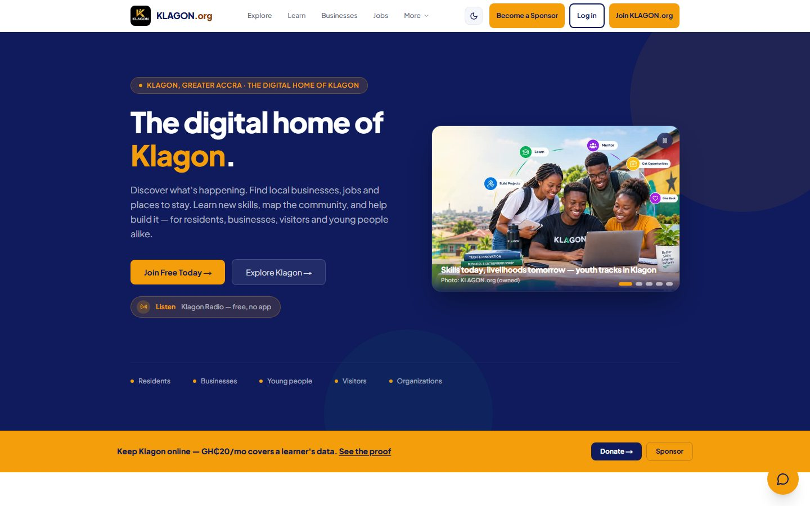
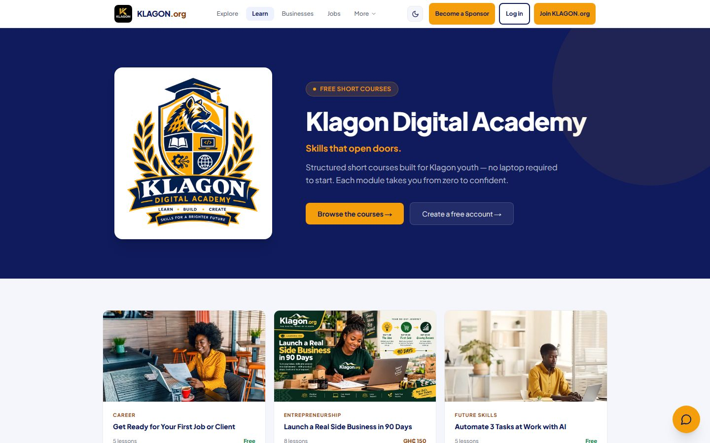
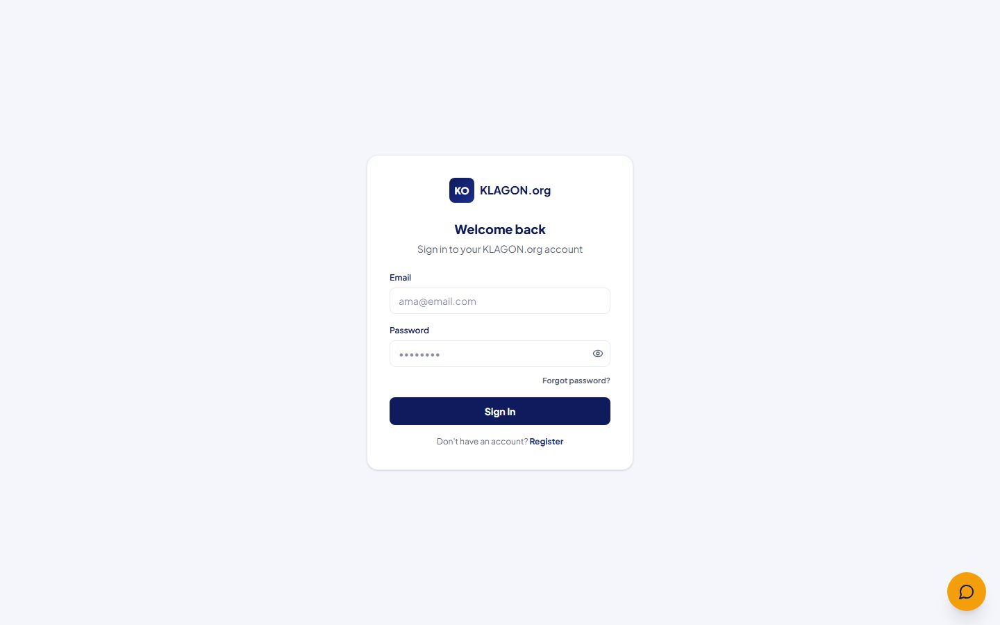
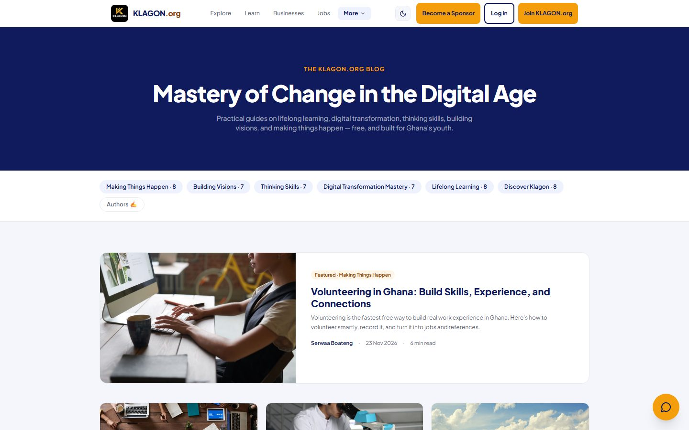
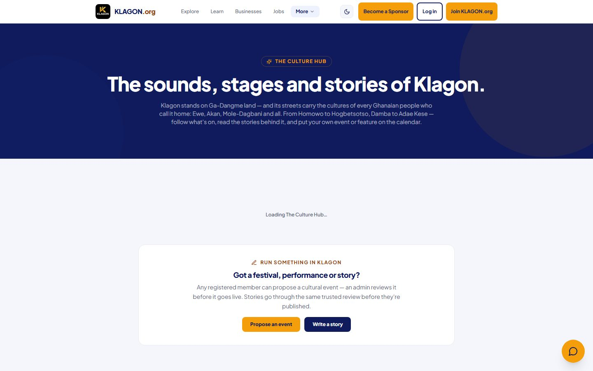
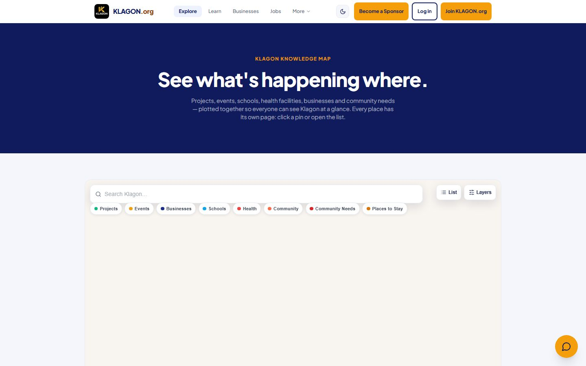
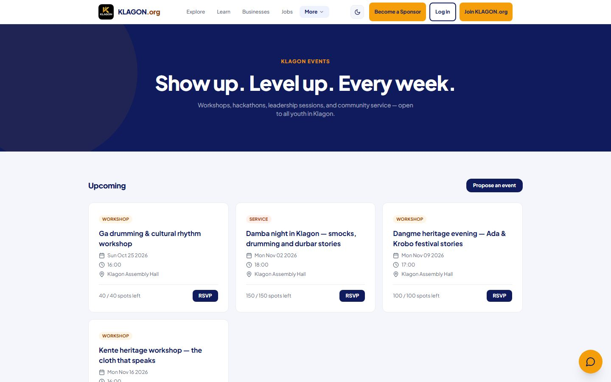
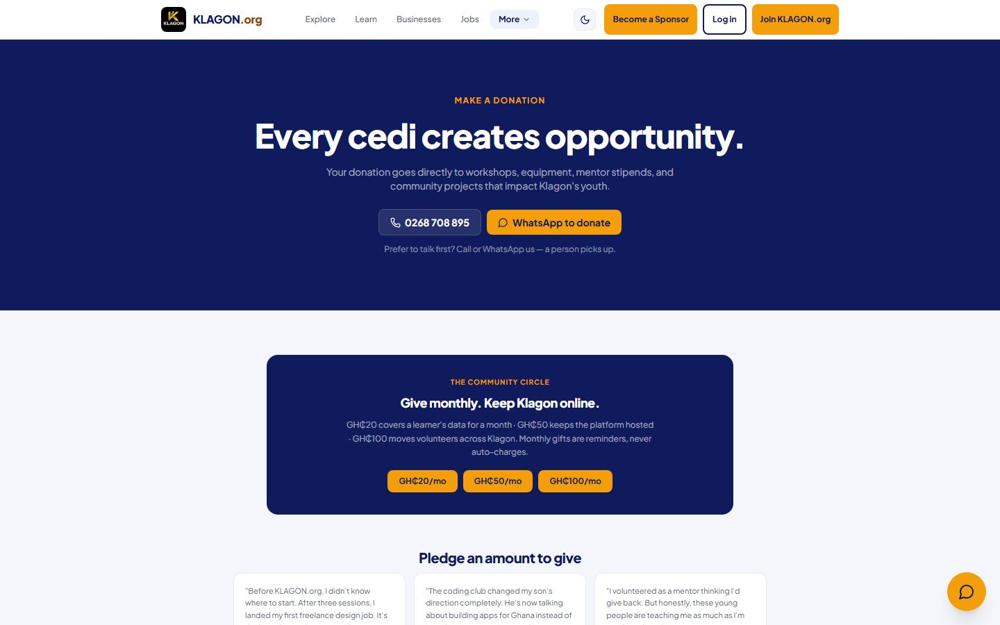
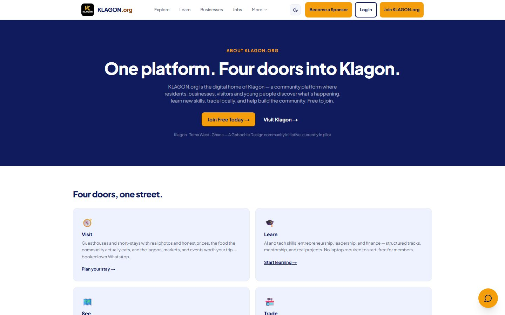

# KLAGON.org — The Digital Home of Klagon

**What it is:** a community platform for Klagon, Ghana — a place to discover local businesses, learn new skills, find jobs and opportunities, get involved in projects, and build a verifiable record of growth. Live at [klagon.org](https://klagon.org).

## Features

- **Discover** — interactive map, business directory, classifieds, events and visit guides
- **Learn** — Digital Academy with courses, gamified journey (Discover → Learn → Build → Earn → Lead → Mentor), AI "Ama" sales agent
- **Community** — Culture Hub, blog, forum, news, volunteer opportunities, projects and Klagon Radio
- **Opportunities** — jobs board, sponsors/donations, business directory
- **Growth tracking** — badges, activity feed, dashboards for members, verified records

## Tech Stack

- **Framework:** [Next.js 15](https://nextjs.org/) (App Router, TypeScript)
- **Styling:** [Tailwind CSS 4](https://tailwindcss.com/)
- **Backend/Auth:** [Supabase](https://supabase.com/) (Postgres + Auth + RLS + Storage) — 87 migrations
- **Workers:** 4 Cloudflare Workers (`workers/agent`, `workers/moolre`, `workers/notify`, `workers/radio-stream-proxy`)
- **Payments:** [Moolre](https://moolre.com/) (Ghana Mobile Money) via payments Worker
- **Testing:** Vitest (46 unit/component tests) + Playwright (18 E2E specs)

## Screenshots

| Home | Learning | Dashboard |
| --- | --- | --- |
|  |  |  |

| Blog | Culture | Map |
| --- | --- | --- |
|  |  |  |

| Events | Donate | About |
| --- | --- | --- |
|  |  |  |

_Live captures from https://klagon.org (see `scripts/capture-screenshots.mjs`)._

## Quick Start

```bash
npm install
cp .env.example .env.local
npm run dev
```

See [`.env.example`](.env.example) for required environment variables (Supabase, AI agent URL, Moolre secrets live in the payments Worker).

## Scripts

| Command | Description |
|---------|-------------|
| `npm run dev` | Start dev server |
| `npm run build` | Production build with verification checks |
| `npm run test` | Run unit tests (Vitest) |
| `npm run test:components` | Run component tests |
| `npm run test:e2e` | Run all E2E tests (Playwright) |
| `npm run lint` | Run ESLint |
| `npm run typecheck` | Type check with TypeScript |

## License

Source-available under [BUSL-1.1](LICENSE). Commercial use requires a paid license.
